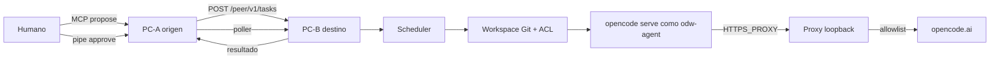

# ODW — Continuar desde otra PC

> **Último commit:** el último de `main` (`git log -1`) · **Rama:** `main` · **Fecha:** 2026-11-26
>
> **Estado:** H0, H2 (pipe/CLI/HMAC) y H3 cerrados. H1 tiene la delegación real en dos PCs
> verificada (2026-11-26); quedan doctor en dos PCs, reinicio a mitad y cobertura para cerrar el
> hito. Quedan artefactos descargables, Telegram real y H4.
> **328/328 pruebas**, build sin advertencias. El token del kit se usó para la prueba y sigue vivo:
> hay que rotarlo y borrar el repo puente.

Este documento es el punto de entrada para retomar el proyecto en otro equipo sin depender de
la memoria de una sesión. El diseño detallado vive en `docs/`; el grafo del código en
`graphify-out/`. Para una puesta en marcha rápida, usa [`../CONTINUE.md`](../CONTINUE.md).

---

## 1. Qué es ODW

Red cooperativa de PCs Windows con OpenCode: un nodo **origen** propone una tarea, un humano la
aprueba y un nodo **destino** la ejecuta en un workspace aislado. El destino devuelve resumen,
rutas cambiadas, commit y diff; el origen lo consulta por la API de pares.



**Reglas que no se negocian**

1. `opencode serve` solo escucha en `127.0.0.1`.
2. No hay aprobación por HTTP ni por herramienta MCP; solo pipe/Telegram.
3. La aprobación va ligada a `task_hash`, expira y es de un solo uso.
4. El agente no puede aprobar sus propias delegaciones.
5. Ninguna ruta absoluta remota entra en el contrato.
6. `odw-agent` no puede leer configuración, base ni claves del nodo.
7. `network: "none"` = sin red arbitraria; solo el proxy del modelo.

---

## 2. Requisitos para otra PC

- **Windows 11 x64** (el sandbox real es Windows: WFP, ACLs, `CreateProcessWithLogonW`).
- **.NET 10 SDK** y Git.
- **OpenCode 2.3.2** (el ejecutable se copia al sandbox; no hace falta el escritorio).
- **Consola elevada** para aprovisionar usuarios, ACLs, WFP y el servicio.
- Para la prueba real entre PCs: **Tailscale** en ambos nodos y ACL que permita el puerto de pares
  (por defecto 7421). Sin Tailscale, usar loopback + túnel SSH; el bind a una IP LAN directa se
  rechaza por diseño.
- Opcional para el grafo: Python 3.11+ y `pip install graphifyy`.

---

## 3. Puesta en marcha desde cero

```powershell
git clone https://github.com/DanielCB096/ODW-OpenCode-Distributed-Worker-Network.git
cd "ODW-OpenCode-Distributed-Worker-Network"

dotnet build Odw.slnx -warnaserror
dotnet test Odw.slnx

# Consola ELEVADA: usuarios odw-agent/odw-svc, DPAPI, ACLs, plantilla y WFP
powershell -ExecutionPolicy Bypass -File tools/provision-sandbox.ps1
dotnet run --project src/Odw.Cli -- sandbox check
dotnet run --project src/Odw.Cli -- sandbox net status
```

El aprovisionamiento crea:

- `odw-agent` (sin privilegios) y `odw-svc` (servicio sin admin);
- `%PROGRAMDATA%\ODW\agent.secret` y `service.secret` (DPAPI de máquina);
- `%PROGRAMDATA%\ODW\opencode\opencode.exe` con RX para el agente;
- `%PROGRAMDATA%\ODW\agent-config\opencode.json` (modelo gratuito, `snapshots=false`);
- `%PROGRAMDATA%\ODW\runtime` para perfiles desechables por tarea;
- ACLs de datos y filtros WFP para `odw-agent` (solo `127.0.0.1:7423`) + `network.state`.

Publica e instala el servicio:

```powershell
dotnet publish src/Odw.Cli -c Release -o C:\ODW\publish -r win-x64 --self-contained false
odw service install `
  --config C:\ODW\node.json `
  --exe C:\ODW\publish\odw.exe `
  --account .\odw-svc `
  --secret %PROGRAMDATA%\ODW\service.secret
```

`odw-svc` necesita **RX** sobre `C:\ODW\publish` y su directorio. Si el config está en
`%PROGRAMDATA%\ODW`, ya tiene F por el aprovisionamiento.

---

## 4. Qué NO está en Git

Nunca copies estos elementos entre PCs; son locales y contienen secretos o estado de máquina:

| Elemento | Dónde | Qué hacer |
|---|---|---|
| Usuarios `odw-agent`/`odw-svc` | SAM local | Crearlos con `provision-sandbox.ps1` |
| `agent.secret`, `service.secret` | `%PROGRAMDATA%\ODW` | Regenerar con el script; nunca copiar |
| `network.state` | `%PROGRAMDATA%\ODW` | Lo escribe `odw sandbox net install` |
| Filtros WFP | BFE | Instalarlos con el script/CLI |
| `node.json`, tokens de par/MCP | `%PROGRAMDATA%\ODW` o config | Crear e intercambiar por USB, Taildrop o gestor de contraseñas |
| `odw.db`, `approvals.key` | data dir | Se generan en el primer arranque |
| Workspaces y runtime | `%PROGRAMDATA%\ODW` | Efímeros; no copiar |
| `opencode.exe` | `%PROGRAMDATA%\ODW\opencode` | Lo copia el aprovisionamiento |

El token de par es **compartido y bidireccional** en el MVP. Intercámbialo por USB, Taildrop o
gestor de contraseñas; nunca por chat, correo, git ni un repo puente.

### Kit de prueba y repo puente (incidente 2026-11-26)

El kit `kit-origen.zip` se transportó en un repo privado temporal. Ese repo **seguía existiendo**
al revisar. El 2026-11-26 se comprobó que su `peer.token` **seguía autenticando** (200) y se usó
para la prueba real; la rotación no se aplicó. Ahora:

1. Rota el token en el destino (`tools/rotate-peer-token.ps1`) y comprueba que el anterior da `401`.
2. Borra el repo puente completo (incluido su historial) y cualquier copia del zip o del kit.
3. Regenera el kit con el token nuevo solo para una prueba posterior y pásalo por
   USB/Taildrop/gestor.
4. No reutilices el kit actual.

El repo puente no se borró el 2026-11-26 por decisión del propietario; queda como pendiente
explícito en `docs/ROADMAP.md`.

---

## 5. Configurar un nodo

Parte de `config/node.example.json`. Campos que importan:

```jsonc
{
  "node_id": "PC-A",
  "peer_api": { "bind": "IP_TAILNET", "port": 7421, "allow_loopback": false },
  "mcp": { "bind": "127.0.0.1", "port": 7422, "token_ref": "env:ODW_MCP_TOKEN" },
  "scheduler": { "enabled": true, "max_concurrent": 1, "poll_seconds": 2 },
  "workspaces": { "root": "%PROGRAMDATA%\\ODW\\workspaces", "keep": false },
  "repos": [ { "name": "SistemaMaestro", "path": "C:\\ruta\\repo", "base_ref": "main" } ],
  "peers": [
    { "node_id": "PC-B", "address": "http://IP_TAILNET_B:7421",
      "token_ref": "env:ODW_PEER_TOKEN", "trust": "trusted" }
  ],
  "sandbox": {
    "run_as_agent": true,
    "network_isolation": true,
    "network_proxy_port": 7423,
    "runtime_root": "%PROGRAMDATA%\\ODW\\runtime",
    "agent_config_path": "%PROGRAMDATA%\\ODW\\agent-config\\opencode.json",
    "network_state_path": "%PROGRAMDATA%\\ODW\\network.state"
  }
}
```

- **Repo de origen legible por `odw-svc`** (es quien clona). Si está en una carpeta privada,
  concede lectura al servicio; el agente no necesita leerlo, solo el workspace clonado.
- Con `run_as_agent` el nodo exige `max_concurrent=1` y `keep=false`; no los cambies sin diseñar
  aislamiento por tarea.
- El origen puede tener `scheduler.enabled=false`; el destino `true`.
- Para TLS opt-in: `peer_api.tls` con PFX y `password_ref`. Sobre Tailscale/SSH no es obligatorio.
- El bind de pares solo acepta tailnet o loopback (`allow_loopback` para pruebas/túnel).

---

## 6. Operación

```powershell
odw service status
odw service uninstall
odw sandbox check
odw sandbox net status
Invoke-RestMethod http://127.0.0.1:7421/peer/v1/health
```

Logs: el servicio escribe en el Event Log; en consola, `odw serve` imprime el estado y los
errores de OpenCode. El workspace y el runtime por tarea se borran al terminar.

### E2E en un solo PC

```powershell
powershell -ExecutionPolicy Bypass -File tools/e2e-loopback.ps1
# escritura: valida changed_paths/commit/diff
powershell -ExecutionPolicy Bypass -File tools/e2e-loopback.ps1 -WriteTask
# conservar logs/config
powershell -ExecutionPolicy Bypass -File tools/e2e-loopback.ps1 -WriteTask -Keep
```

El script arranca dos nodos como `odw-svc`, propone por MCP, aprueba por el pipe y comprueba el
resultado. No sustituye a Tailscale/dos PCs.

---

## 7. Evidencia actual

```text
328/328 pruebas · build 0 warnings
commit actual en `main`
```

- E2E loopback `read_only`: `DONE` / `E2E-LOOPBACK`.
- E2E loopback `-WriteTask`: `DONE` / `E2E-WRITE`, `changed_paths=["src/e2e-changed.txt"]`,
  commit y diff.
- Nodo real como `odw-svc` con scheduler, `odw-agent`, WFP, proxy y runtime.
- Aprobación por pipe, propuesta MCP y poller del origen.
- Servicio Windows instalado/arrancado como `.\odw-svc`.
- **Prueba real en dos PCs (2026-11-26):** `PC-OFICINA` → `PC-CASA` por Tailscale.
  - `read_only`: tarea `01M8C901HCSFCE93QJH1P3YRYD`, `DONE`, `E2E-REMOTE`.
  - `read_write_worktree`: tarea `01M8C90GX6903D3VZBMEGXKAD9`, `DONE`, `E2E-REMOTE-WRITE`,
    `changed_paths=["src/remoto.txt"]`, commit `48d36b92039fa97ecce1e8fc0627b1dc7dd1553e`
    y diff inline (`+HOLA`).
- Revisión 2026-11-26: 7 scripts de `tools/` parsean, build 0 warnings, 328/328 pruebas y grafo
  regenerado.

---

## 8. Límites y pendientes

| Tema | Estado |
|---|---|
| Prueba en dos PCs con Tailscale | ✅ delegación real verificada el 2026-11-26 (`read_only` + `read_write_worktree`); quedan criterios de H1 |
| Repo puente con el kit | ⛔ token verificado vivo; pendiente rotar y borrar el repo |
| Artefactos descargables | ⬜ el diff va inline (256 KiB); el bundle/artefacto no |
| `commit`/`branch` | ✅ se crean, pero el workspace se borra: el diff es la evidencia; el SHA es informativo |
| `network: "allow"` | ⛔ rechazado (filtro por SID, no por tarea) |
| WFP en servicio sin admin | ✅ marca `network.state`; un admin puede retirar filtros |
| Telegram real | ⬜ implementado, sin probar con bot |
| H4 mensajes/cancelación/leases | ⬜ siguiente hito grande |
| `%PROGRAMDATA%\ODW` legible por el agente | ✅ solo listar/stat; archivos protegidos |
| Derechos de logon | ✅ red/RDP denegados; interactivo local necesario para `CreateProcessWithLogonW` |

---

## 9. Grafo del proyecto

El grafo está en `graphify-out/`:

- `graph.json` — datos para consultas y para el agente.
- `GRAPH_REPORT.md` — auditoría, comunidades, nodos dios y conexiones.
- `graph.html` — visualización interactiva en el navegador.

Consulta desde otra PC:

```powershell
python -m graphify query "¿Cómo se aisla la red del agente?"
python -m graphify path "McpServer" "OpenCodeTaskRunner"
python -m graphify explain "PolicyEngine"
```

Regenerar (AST de código + chunks semánticos de docs):

```powershell
python tools/graphify-project.py
```

Si no está instalado: `pip install graphifyy`. La extracción AST no necesita API key; la semántica
de docs se puede añadir con un subagente que escriba `graphify-out/.graphify_chunk_*.json` y
volviendo a ejecutar el script.

Preguntas útiles para el grafo:

- ¿Qué camino une la propuesta MCP con el scheduler y el workspace?
- ¿Dónde se aplican las ACLs y el filtro WFP?
- ¿Qué componentes participan en la aprobación por pipe?
- ¿Qué queda pendiente en H4?

---

## 10. Mapa de documentación

| Documento | Fuente de verdad para |
|---|---|
| `README.md` | Estado, arranque, CLI y sandbox |
| `ARCHITECTURE.md` | Visión y decisiones originales |
| `docs/IMPLEMENTATION.md` | Qué está implementado, cifras, configuración y comandos |
| `docs/ROADMAP.md` | Hitos y criterios de aceptación |
| `docs/SECURITY.md` | Modelo de amenazas, identidades, ACLs, red y aprobaciones |
| `docs/DOMAIN-MODEL.md` | Contrato, estados, hash, resultado |
| `docs/PROTOCOL.md` | API de pares, outbox, poller |
| `docs/PERSISTENCE.md` | SQLite, WAL, migraciones, auditoría |
| `docs/MCP-FACADE.md` | Herramientas MCP y su seguridad |
| `docs/OPENCODE-ADAPTER.md` | Cliente/SSE/ejecutor de OpenCode |
| `docs/PLANNER-POLICY.md` | Planner y Policy Engine |
| `docs/TESTING.md` | Estrategia y casos hostiles |
| `docs/HANDOFF.md` | Este documento: continuidad desde otra PC |
| `graphify-out/GRAPH_REPORT.md` | Mapa generado del código y docs |

---

## 11. Próximos pasos recomendados

1. **Cerrar el incidente del kit**: rotar el token, borrar el repo puente y borrar el kit.
2. **Completar H1**: `odw doctor` en dos PCs, reinicio del destino a mitad de tarea y cobertura.
3. **Artefactos descargables**: `GET /peer/v1/tasks/{id}/artifacts/{name}` + bundle/parche completo.
4. **Telegram** con un bot real.
5. **H4**: mensajes, cancelación remota, leases y reconciliación tras reinicio.
6. **H0-6**: aislamiento por directorio con instancias de OpenCode ya separadas.

---

## 12. Checklist antes de continuar

- [ ] `git status` limpio y `dotnet test Odw.slnx` en verde.
- [ ] `odw sandbox check`: `admin`, `agent`, `acls`, `network`, `enforced` en `True`.
- [ ] `tools/provision-sandbox.ps1` ejecutado en esta PC (no copiar secretos de otra).
- [ ] Repo de trabajo legible por `odw-svc`.
- [ ] Token de par intercambiado por canal seguro; `node.json` sin secretos literales.
- [ ] `tools/e2e-loopback.ps1` pasa en read_only y `-WriteTask`.
- [ ] Tailscale/SSH decidido antes de intentar dos máquinas.
